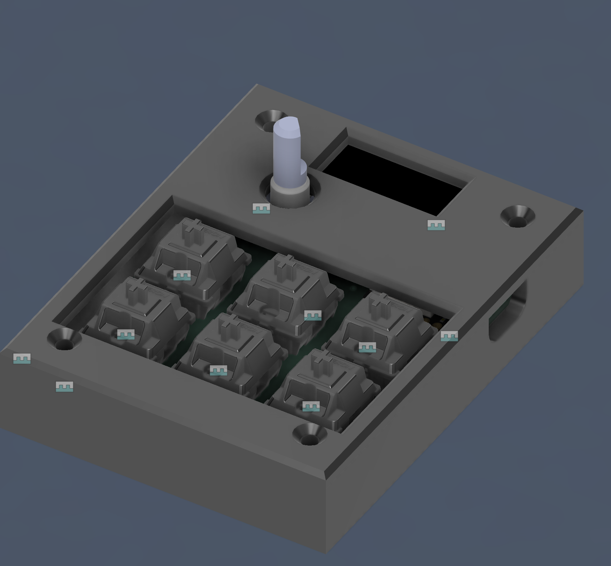
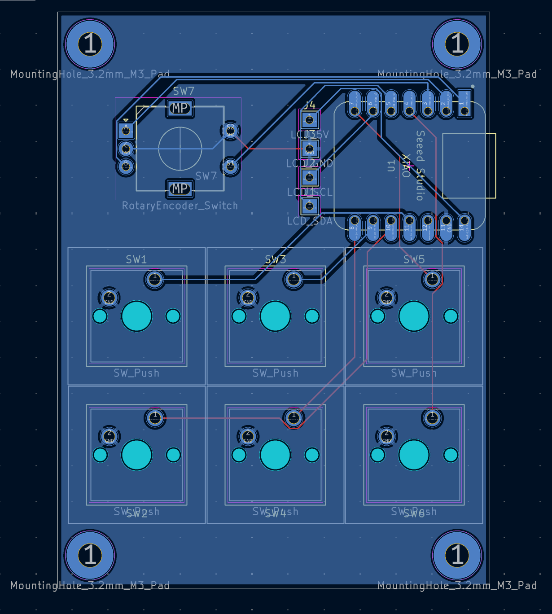
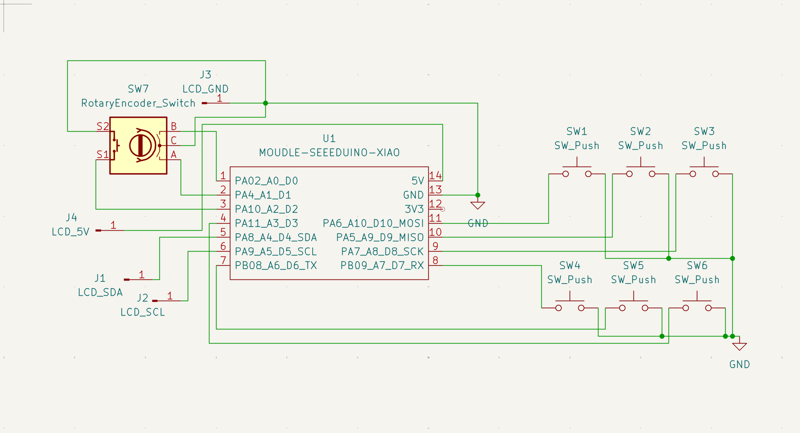

# CodePad

CodePad is a custom hack pad (macro pad) with 6 keys, a rotary encoder and a screen!
I designed this project for the Stardance Hackpad mission.

## Features

- 128x32 OLED Display
- EC11 Rotary encoder (for volume/anything)
- 6 Cherry MX-style keys

## CAD

CodePad is printed in two pieces, the lid and the case.
There are 4 screws that go through the lid, sqeeze down the pcb and go into threaded inserts in the bottom case.
You will need 4 M3 bolts and the threaded inserts for them.
This was made in Fusion360.

## PCB

The PCB was made in KiCad. I added a ground plane.

## Firmware

The firmware is built for CircuitPython and the code is in the [`firmware`](./firmware) folder.
You will need to install CircuitPython on the device and the necessary librarie, then upload the [`code.py`](./firmware/code.py).

## BOM

- 6x [Cherry MX Switches](https://www.amazon.com/Deftomo-Keyboard-Switches-Mechanical-Replacement/dp/B0FSWLNL21) (~$0.96)
- 6x [DSA Keycaps](https://www.amazon.com/Mechkeeb-Profile-Switches-Keyboard-Replacement/dp/B0BWDTBF1L) (~$2.25)
- 1x [0.91" 128x32 OLED Display](https://www.amazon.com/dp/B0F3CXTWZT) (~$7.99)
- 1x [EC11 Rotary Encoder](https://www.amazon.com/DIYhz-Rotary-Encoder-Digital-Potentiometer/dp/B07D3DF8TK) (~$1.00)
- 1x [XIAO RP2040](https://www.seeedstudio.com/XIAO-RP2040-v1-0-p-5026.html) (~$3.99)
- 4x [M3 bolts](https://www.amazon.com/Machine-Screws-Countersunk-Phillips-Assortment/dp/B0CCPH974T) (~$0.07)
- 4x [M3 heat-set threaded inserts](https://www.amazon.com/dp/B0FDKYTMZ8) (~$0.26)
- 1x Case (2 3D printed parts) (Print the [case](production/Case.stl) and [lid](production/Lid.stl)).
- 1x PCB (2 layer) (The gerbers are [here](production/gerbers.zip)). Can be manufactured by a company such as [JLCPCB](https://jlcpcb.com) (~$2.00).

**Estimated total: ~$18.52** (prorated from multi-packs, so you'll actually pay more up front for the full packs).
